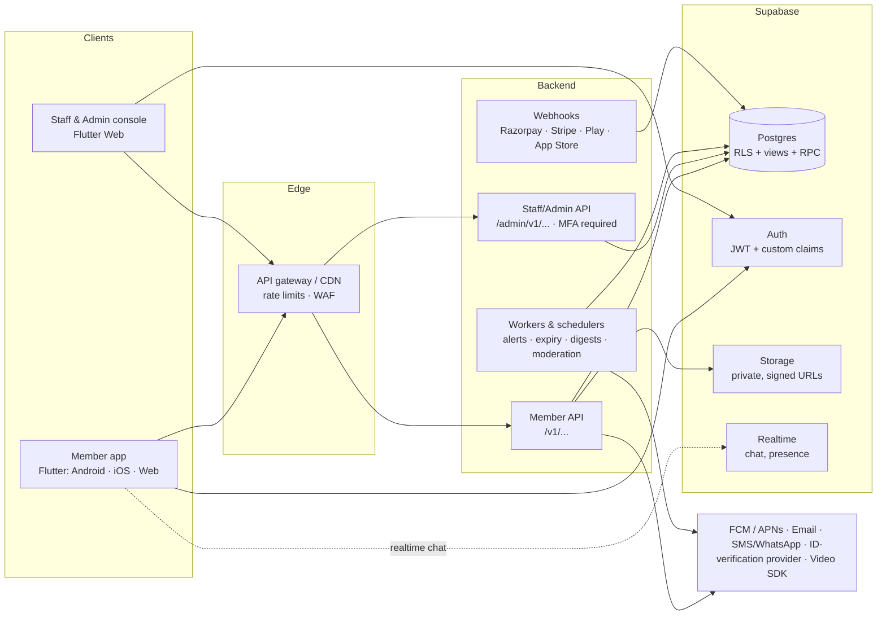
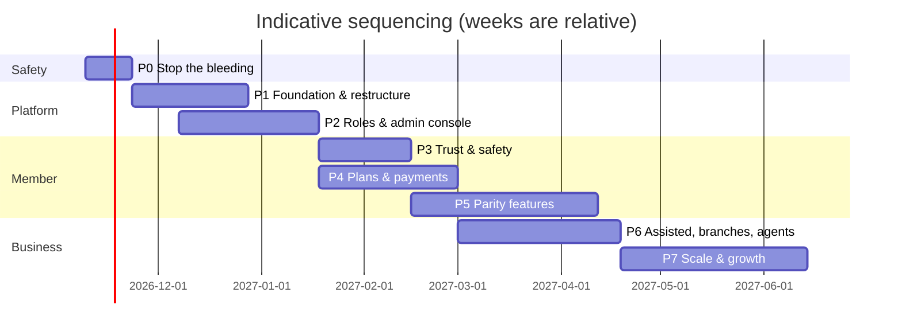

# TryMeYourPartner: Product Strategy, Gap Analysis and Phased Roadmap

> **Status:** Draft v1 · **Date:** 2026-11-05 · **Scope:** member apps (Android, iOS, Web), staff/admin console, backend, data, security, monetization
>
> This document has two inputs:
> 1. **A code-level audit** of this repository (`lib/`, `sql/`, `supabase_*.sql`) as of commit `fa22a92`.
> 2. **A market review** of leading Indian matrimony platforms (BharatMatrimony/TamilMatrimony, Shaadi.com, Jeevansathi, Betterhalf, Elite Matrimony) and matrimony-bureau software.
>
> Competitor facts come from public sources (app-store listings, help centres, press and coupon sites). They are indicative and **must be re-checked on the official sites before you rely on prices or quotas**. Sources are listed at the end.

---

## Table of contents

1. [Executive summary](#1-executive-summary)
2. [Critical findings: fix before anything else](#2-critical-findings-fix-before-anything-else)
3. [Current state: code-level audit](#3-current-state-code-level-audit)
4. [Market analysis and competitor benchmark](#4-market-analysis-and-competitor-benchmark)
5. [Gap analysis](#5-gap-analysis)
6. [Roles, logins and access control](#6-roles-logins-and-access-control)
7. [Admin-controlled subscription plans and monetization](#7-admin-controlled-subscription-plans-and-monetization)
8. [Target architecture (API separation)](#8-target-architecture-api-separation)
9. [Folder and repository restructuring](#9-folder-and-repository-restructuring)
10. [UI/UX improvements: decoration to real functionality](#10-uiux-improvements-decoration-to-real-functionality)
11. [Compliance, privacy and policy](#11-compliance-privacy-and-policy)
12. [Phased implementation plan](#12-phased-implementation-plan)
13. [Open decisions](#13-open-decisions)
14. [Sources](#14-sources)

---

## 1. Executive summary

**What exists today.** A Flutter app (Provider state management) talking **directly** to Supabase (Postgres + Auth + Storage + Realtime). Members can:
- register and build a profile
- search with filters and save searches
- send and accept interests, shortlist, and see who viewed them
- chat in realtime
- exchange contact details by request
- block and report other members

An "HTTP backend mode" exists in the client, but no server implements it. About 26.8k lines of Dart, with one widget test and no CI.

**What a professional matrimony service needs that is missing:**
- **Operational backbone:** no admin, staff, branch or agent logins; no moderation console; no CRM for assisted service; no audit log.
- **Trust:** verification badges and subscription tiers can be **set by the member themselves**; there is no ID or phone verification and no photo moderation.
- **Monetization:** plans are a hard-coded `tier` text; the "Upgrade" button is a placeholder; there is no payment integration.
- **Market-standard member features:** horoscope (jathagam/nakshatra) matching, push notifications, Tamil and other languages, family-managed profiles, photo privacy, video calls.
- **Engineering:** no separate dev/staging/prod; business rules run on the client; duplicate and dead screens; giant files (1.4k–2k lines); flat folder structure.

**Strategy in one line:** close the safety and trust gap first. Then build the **admin console and role model** and the **admin-controlled plan catalog with payments**. Then reach feature parity, and differentiate on *hybrid online + branch/agent-assisted service for the Tamil diaspora*.

The plan is split into **8 phases (P0–P7)** in [section 12](#12-phased-implementation-plan).

---

## 2. Critical findings: fix before anything else

These were verified against the live project and the SQL in this repo.

| # | Finding | Evidence | Impact |
|---|---------|----------|--------|
| C1 | **All active profiles can be read without logging in, using only the public key.** The policy has no `TO authenticated` restriction. An anonymous request to `/rest/v1/matrimonial_profiles` returned a count of 58 rows. | `supabase_matrimonial_complete.sql:191` (`USING (is_active = true OR …)`) | Exposes **email, date of birth, income, caste, location, `auth_user_id`** of every member to anyone on the internet. A personal-data breach under DPDP. |
| C2 | **Members can make themselves "verified".** The client writes `is_verified` on profile save, and the update policy allows any column. | `lib/services/matrimonial_service.dart:1381`, `supabase_matrimonial_complete.sql:199` | The verified badge is meaningless; scammers can fake trust. |
| C3 | **Members can grant themselves a paid plan.** `subscriptions` has a `FOR ALL` owner policy, and the client inserts rows itself. | `sql/subscriptions_and_contacts.sql:16`, `lib/services/subscription_service.dart:31` | Free premium; revenue leakage once payments exist. |
| C4 | **Members can insert their own phone/email verifications.** | `sql/verifications.sql:23` (`FOR ALL … WITH CHECK owner`) | Fake "phone verified" badges. |
| C5 | **Development runs against the production Supabase project.** The dashboard shows `main · PRODUCTION`, and there is no staging. | Supabase dashboard; `lib/config/supabase_config.dart` | Test data and experiments land in production. |
| C7 | **Any caller could delete any member's profile.** `delete_profile_and_related(p_profile_id)` and `restore_profile_from_deleted(p_deleted_id)` run with elevated rights and never check who is calling. | `sql/deleted_users.sql:14, 67` | Account destruction by any user (and possibly anonymous visitors, under Supabase's default function grants). |
| C6 | **A legacy anon JWT is hard-coded as the default key.** Legacy keys are being retired by Supabase in early 2027. | `lib/config/supabase_config.dart:3-6` | The app breaks when legacy keys are switched off. |

**Immediate remediation (Phase 0):**
- **C1:** Add `TO authenticated` to the policy, and move member-facing reads to a `public_profiles` **view** that leaves out email, exact DOB (show age), `auth_user_id` and income ranges according to the viewer's entitlement.
- **C2–C4:**
  - Revoke `UPDATE` on `is_verified`, `is_active` (where moderation-driven), `total_views` and `total_interests` from `authenticated`, using column privileges or a `BEFORE UPDATE` trigger that rejects changes.
  - Make `subscriptions` and `verifications` **read-only** to members; only server code (service role / API) writes them.
- **C5:** Create a separate `staging` Supabase project. Move schema to versioned migrations (see [section 9](#9-folder-and-repository-restructuring)).
- **C6:** Switch to the publishable key (`sb_publishable_…`) passed via `--dart-define`.
- **C7:** Move the original functions to a private schema behind public wrappers that check the caller; revoke function execution from anonymous visitors.

**Status:** C1–C4, C6 and C7 are implemented in `supabase/migrations/20261105120000_phase0_security_hardening.sql` plus app changes, tested on a local copy of the schema. They take effect once the migration is applied (see `supabase/README.md`). C5 (staging project) needs the owner to create it. Dates of birth, income and `auth_user_id` remain visible to logged-in members until the Phase 2 safe-profile view.

---

## 3. Current state: code-level audit

### 3.1 Stack and layering

| Layer | Today | Notes |
|---|---|---|
| UI | Flutter 3.32 (`sdk ^3.8.1`), Material, `google_fonts` | Light theme only (`lib/main.dart:66` sets `darkTheme: AppTheme.lightTheme`) |
| State | `provider`: `AuthProvider`, `MatrimonialProvider` (1,307 lines) | The provider holds business logic, including match scoring (`matrimonial_provider.dart:1108`) |
| Navigation | Imperative `Navigator.push`, no router | No deep links or web URLs per screen |
| Data access | Two parallel stacks: `lib/services/*` (static Supabase calls, `matrimonial_service.dart` 1,854 lines) **and** `lib/core/services` interfaces + `lib/data/{supabase,http}` implementations via `lib/di/service_locator.dart` | Half-migrated; screens use both |
| Backend | Supabase Postgres + Auth (email, Google OAuth) + Storage (private `profiles` bucket, signed URLs) + Realtime | No server code; all rules are RLS or client-side |
| Schema | `supabase_matrimonial_complete.sql` + 18 ad-hoc scripts in `sql/` + 15 archived in `archive/sql/` | No migration ordering or versioning |
| Tests / CI | 1 widget test, no `.github/` | |

### 3.2 Feature inventory: real vs. decorative

| Area | Status | Notes |
|---|---|---|
| Registration & profile edit | ✅ Real | `simple_registration_screen.dart`, `profile_edit_screen.dart` (2,011 lines) |
| Profile completion gate | ✅ Real | `profile_completion_gate.dart` |
| Search + filters + saved searches | ✅ Real (client) | Saved-search **alerts** have no background job |
| Interests, shortlist, viewers | ✅ Real | |
| Chat (realtime, receipts, typing, icebreakers) | ✅ Real (Supabase) | No media, voice or moderation |
| Contact exchange handshake | ✅ Real | |
| Block & report | ✅ Real (member side) | **No one reviews reports**: no moderation console |
| Notifications | 🟡 In-app only | `NotificationChannel { inApp, email, sms, push }` is just an enum (`lib/core/services/notification_channels.dart`); `DeviceTokenService` is a no-op |
| Compatibility score | 🟡 Client-side only | Not explainable, not consistent across devices, can't be tuned by admins |
| Subscription / plan | 🔴 Decorative | Shows "Plan: FREE"; **Upgrade → "coming soon" snackbar** (`profile_screen.dart:165`) |
| Settings: notifications, security, help, about | 🔴 Decorative | Snackbars at `profile_screen.dart:1230, 1236, 1242, 1248` |
| Profile menu: "Interests", "Matches" | 🔴 Decorative | Snackbars at `profile_screen.dart:1205, 1212` instead of navigating |
| Verified badge | 🔴 Untrustworthy | Self-set (see C2) |
| HTTP backend mode | 🔴 Stub | No server; `http_match_service.dart:9` throws `UnimplementedError` |
| Dark mode | 🔴 Missing | Dark theme points to light theme |

### 3.3 Dead and duplicate code (safe to delete in Phase 1)

Nothing in `lib/` imports these files:

- **Screens:**
  - `matrimonial_home_screen.dart` (1,420 lines), superseded by `new_matrimonial_home_screen.dart`
  - `notifications_screen.dart`, `unified_notifications_screen.dart` (3 notification screens exist; only `notifications_pager_screen.dart` is used)
  - `contact_requests_inbox_screen.dart`, `intro_screen.dart`, `mock_data_test_screen.dart`
- **Services and models:**
  - `services/mock_matrimonial_data.dart` (667 lines)
  - `matrimonial_service_OLD.dart` and `matrimonial_service_backup.dart` (both empty)
  - `messaging_service.dart`, `device_token_service.dart`
  - `services/auth/supabase_auth_repository.dart`, `models/user.dart`
  - `data/*/…_match_service.dart`, `core/services/notification_channels.dart`
- **Widgets and utils:** `widgets/empty_state_widget.dart`, `utils/video_url_helper.dart`
- **Root docs:** `README.md`, `MIGRATION_PLAN.md`, `project_flow.md`, `README_BACKEND_MODE.md` and `PROJECT_INVENTORY_UNUSED_AND_DOCS.md` are empty files.
- **Assets:** `pubspec.yaml:94` declares a missing `assets/images/` folder, which causes an analyzer warning. The 1 MB+ intro video is bundled in the app.

### 3.4 Data model gaps (for a professional service)

- **No horoscope fields:** rasi, nakshatra, lagnam, dosham (chevvai/rahu-ketu), gothram, birth time and place. These are standard for Tamil matrimony.
- No `mother_tongue`, `diet`, `drinking`/`smoking`, `residency_status` / `visa`, `country` (only Indian `state`/`district`). This is weak for the **diaspora** positioning.
- No `profile_created_by` (self/parent/sibling/relative/agent) or family-managed account link.
- No organisation entities: `branches`, `teams`, `staff`, `agents`, `leads`, `assignments`, `commissions`, `audit_log`.
- No plan catalog: `plans`, `plan_prices`, `entitlements`, `orders`, `payments`, `coupons`, `invoices`.

---

## 4. Market analysis and competitor benchmark

### 4.1 Competitive landscape

| Player | Positioning | Notable capabilities (public sources) |
|---|---|---|
| **BharatMatrimony / TamilMatrimony** (Matrimony.com, Chennai) | Market leader; community and regional portals (TamilMatrimony app available in Tamil) | AI matching ("MIMA"); horoscope/jathagam on profiles; government-ID verified **Prime** profiles; NRI search; **assisted service with a Relationship Manager**; Gold/Diamond/Platinum tiers (3/6/12 months) with contact-view quotas; offline events (e.g. TamilMatrimony "Thirumana Vaibhava Vizha" in Coimbatore) |
| **Shaadi.com** | Pan-India + NRI (NRI Shaadi, community apps) | **Blue-tick** verification (claims ~40% more connection requests for verified members); government-ID verification; **Shaadi Meet** 1:1 video calls with caller privacy and time settings; **Shaadi Live** group video; Gold/Diamond/Platinum and "Plus" tiers with spotlight and bold listing; contact-privacy controls; 30-day money-back for eligible members; Truecaller partnership for safety |
| **Jeevansathi** (Info Edge) | North/West India focus | Plans like eRishta / eValue / eAdvantage / **JS Exclusive** (RM-assisted); contact-view quotas (e.g. hundreds of contacts "until marriage"); photo verification; safety centre |
| **Betterhalf.ai** | Urban professionals, AI-first | Verification-first; **24-hour profile boost**; AI matchmaking; video dating; wedding services |
| **Elite Matrimony** (Matrimony.com) | High-net-worth, discretion | Privacy and discretion above all; personal matchmakers |
| **Bureau software** (e.g. Rishta Desk, Avancezone, Logicspice) | SaaS for local marriage bureaus | Multi-agent, white-label domain, CRM module, profile-count-based pricing, role-based access per branch/franchise |

### 4.2 Plan structures in the market (indicative)

| Pattern | Seen at | Typical levers |
|---|---|---|
| **Tiered self-service** (Gold → Diamond → Platinum) | BharatMatrimony, Shaadi | Duration (3/6/12 months), **contact-view quota**, unlimited messaging, priority in search, horoscope matching |
| **Visibility "Plus" variants** | Shaadi (Diamond Plus, Platinum Plus) | Spotlight, bold listing, top-of-search, let free members contact you |
| **Verified "Prime" variant** | BharatMatrimony | ID verification included, verified-only discovery |
| **Assisted / Exclusive** | BharatMatrimony Assisted, JS Exclusive, Elite | Dedicated RM, curated shortlists, horoscope and family consultation; much higher price point |
| **Add-ons / boosts** | Betterhalf (24h boost), Shaadi Spotlight | One-off visibility purchases |
| **Quota "until marriage"** | Jeevansathi | Contacts that don't expire with the plan |

Reported price points are wide-ranging (roughly ₹4k–₹21k for 3–12-month self-service tiers, and tens of thousands for assisted). They also vary by region and channel. **This is exactly why plans must be admin-configurable rather than hard-coded** (see [section 7](#7-admin-controlled-subscription-plans-and-monetization)).

### 4.3 Market trends that matter for us

1. **Verification is the product.** Users expect visible badges (ID, phone, photo) and reviewed profiles.
2. **Photo privacy and women-first defaults.** Blur or watermark until mutual interest, enforced **server-side**, not as a cosmetic overlay.
3. **Family participation.** Parent/sibling-managed profiles and shared shortlists.
4. **Vernacular UX** for Tier-2/3 and the diaspora's parents (Tamil first).
5. **Hybrid online + assisted.** RM/agent-assisted plans are a major revenue line for incumbents, but reviews show service quality is a pain point. **This is an opportunity for a transparent, SLA-driven assisted service** built on a proper CRM.
6. **In-app video calls** with privacy controls before sharing phone numbers.

### 4.4 Positioning and differentiation

**"Verified, family-friendly, Tamil-first matrimony for the global diaspora, with an accountable local branch or agent when you want one."**

- **Trust by default:** every visible profile is moderated; badges can only be granted by staff or verified providers.
- **Transparent assisted service:** members see what their RM or agent did (shortlists sent, calls logged, next steps). SLAs are tracked in the CRM and visible to team leads.
- **Diaspora-aware:** country, residency/visa, time zones, multi-currency pricing, NRI search.
- **Jathagam-native:** porutham (10-point compatibility) as a first-class filter, not a PDF attachment.

---

## 5. Gap analysis

Priority: **P0** = blocker/safety, **P1** = needed to launch as a paid service, **P2** = parity, **P3** = differentiation/scale.

| # | Capability | Market | Us today | Gap | Priority | Phase |
|---|---|---|---|---|---|---|
| G1 | Data protection (RLS, field-level privacy) | Expected | Public profile dump (C1) | Critical | P0 | P0 |
| G2 | Trusted verification (ID, phone OTP, photo, badges granted by staff) | Standard | Self-set | Critical | P0 | P0, P3 |
| G3 | Staff/admin logins and role hierarchy | Standard for agencies | None | Critical | P1 | P2 |
| G4 | Moderation console (reports, photos, profiles) | Standard | None | Critical | P1 | P2 |
| G5 | Admin-managed plans, pricing, coupons | Standard | Hard-coded `tier` | Critical | P1 | P4 |
| G6 | Payments (web gateway + Play Billing + Apple IAP) | Standard | None | Critical | P1 | P4 |
| G7 | Server-side entitlements (contact-view quota, chat, filters) | Standard | Client checks only | High | P1 | P4 |
| G8 | Push notifications (FCM/APNs), email, SMS/WhatsApp | Standard | In-app only | High | P1 | P5 |
| G9 | Horoscope / porutham matching | Standard (Tamil) | None | High | P1 | P5 |
| G10 | Tamil + multi-language UI | Standard (TamilMatrimony) | English only | High | P2 | P5 |
| G11 | Photo privacy (blur / approved-only / watermark) | Standard | None | High | P2 | P3 |
| G12 | Family-managed profiles / profile created-by | Common | None | Medium | P2 | P5 |
| G13 | Video calls with privacy controls | Shaadi Meet, Betterhalf | None | Medium | P2 | P5 |
| G14 | Assisted service CRM (leads, RM assignment, SLAs) | BM Assisted, JS Exclusive | None | High (revenue) | P1 | P6 |
| G15 | Branch / agent / commission management | Bureau software | None | High (business model) | P1 | P6 |
| G16 | Explainable, server-side matching | AI matching at incumbents | Client heuristic | Medium | P2 | P5, P7 |
| G17 | Profile boost / spotlight add-ons | Shaadi, Betterhalf | None | Medium | P2 | P4 |
| G18 | Saved-search alerts and digests (background jobs) | Standard | UI only | Medium | P2 | P5 |
| G19 | Analytics dashboards (funnel, revenue, branch KPIs) | Standard | None | Medium | P2 | P6, P7 |
| G20 | Environments, CI/CD, tests, observability | Hygiene | None | High | P0 | P1 |
| G21 | Deep links and web URLs (shareable profile links) | Common | None | Medium | P2 | P1 |
| G22 | DPDP compliance (consent, notices, grievance, deletion) | Mandatory | Partial (soft delete) | High | P1 | P0–P5 |
| G23 | Success stories, events (offline meets) | BM events | None | Low | P3 | P7 |

---

## 6. Roles, logins and access control

### 6.1 Role hierarchy

```
system_admin  ─ platform "god" role: all settings, integrations, keys, role definitions, feature flags
  └─ super_admin  ─ business owner: plans, pricing, offers, branches, commission rules, business reports
       └─ admin  ─ operations head: moderation, verification, staff management across branches
            └─ branch_manager ("branch login")  ─ one branch: its staff, agents, members, targets
                 └─ team_lead  ─ one team: assigns leads, reviews work, approves escalations
                      ├─ staff  ─ executes: verification checks, RM work, member calls, data entry
                      └─ agent  ─ external/franchise partner: registers members, earns commission
member         ─ end user (bride/groom)
family_member  ─ parent/sibling linked to a member profile with delegated permissions
```

`staff` are employees; `agent` is an external, commission-based partner. Agents get a **restricted** portal: their own registered members and their own commission.

### 6.2 Permission matrix (default; editable by `system_admin`)

| Capability | sys_admin | super_admin | admin | branch_mgr | team_lead | staff | agent | member |
|---|---|---|---|---|---|---|---|---|
| Platform settings, integrations, API keys, feature flags | ✅ | ❌ | ❌ | ❌ | ❌ | ❌ | ❌ | ❌ |
| Define roles / permission sets | ✅ | ❌ | ❌ | ❌ | ❌ | ❌ | ❌ | ❌ |
| Plans, pricing, coupons, plan display | ✅ | ✅ | view | ❌ | ❌ | ❌ | ❌ | ❌ |
| Commission rules, branch creation, targets | ✅ | ✅ | view | view own | ❌ | ❌ | view own | ❌ |
| Business & revenue reports (all) | ✅ | ✅ | ops only | own branch | own team | ❌ | own | ❌ |
| Create / disable staff accounts | ✅ | ✅ | ✅ | own branch | ❌ | ❌ | ❌ | ❌ |
| Moderate reports, photos, profiles | ✅ | ❌ | ✅ | own branch | own team | assigned | ❌ | ❌ |
| Grant verification badges | ✅ | ❌ | ✅ | ✅ | ✅ | assigned (maker) | ❌ | ❌ |
| View member PII (phone/email) | audited | audited | audited | own branch, audited | own team, audited | assigned, audited | own registered | per entitlement |
| Register a member on their behalf | ❌ | ❌ | ✅ | ✅ | ✅ | ✅ | ✅ | — |
| Assign leads / RM | ✅ | ❌ | ✅ | own branch | own team | ❌ | ❌ | ❌ |
| Refunds, manual plan grants | ✅ | ✅ | ✅ (limit) | request | ❌ | ❌ | ❌ | ❌ |
| Impersonate a user (support) | ✅ (audited, time-boxed) | ❌ | ❌ | ❌ | ❌ | ❌ | ❌ | ❌ |

### 6.3 Design rules

- **One identity system, separate apps.** All users authenticate with Supabase Auth. Roles live in our own tables, not in app code: `staff_accounts(user_id, role, branch_id, team_id, status)` and `role_permissions(role, permission)`. Supabase **custom access token hook** puts `role`, `branch_id` and `team_id` into the JWT so that RLS and the API can scope queries.
- **RBAC plus scope (ABAC).** The permission says *what*; the org scope (`branch_id`, `team_id`, `assigned_to`) says *which records*.
- **Maker–checker** for sensitive actions: verification badge grants, refunds, manual plan grants and PII exports need a second approver above a threshold.
- **MFA is mandatory** for all staff roles (TOTP); IP or device allow-listing is optional for `system_admin`.
- **Audit log, append-only** (`audit_log`): who, what, which record, before/after, IP, reason. Every PII view by staff is logged.
- **Staff never log into the member app**, and members never get console access. The console is a separate app (see [section 8](#8-target-architecture-api-separation)).
- **Break-glass:** at least two `system_admin` accounts, one stored offline, with alerts on use.

### 6.4 Organisation data model (new tables)

`organisations` (for future white-label) → `regions` → `branches` → `teams` → `staff_accounts`. Also:
- `agents(id, user_id, branch_id, commission_plan_id, kyc_status)`
- `member_assignments(member_id, branch_id, rm_staff_id, agent_id, source)`
- `leads(id, source, status, branch_id, assigned_to, next_action_at)` and `activities(lead_or_member_id, type, notes, by, at)` for calls, meetings and shortlists sent
- `commission_rules`, `commission_ledger`
- `audit_log`

---

## 7. Admin-controlled subscription plans and monetization

**Requirement: everything about plans is created, priced and displayed from the admin console. The apps render whatever the catalog says, and nothing about plans is hard-coded.**

### 7.1 Catalog data model

```
entitlement_types        -- the vocabulary of features (system_admin manages)
  key ('contact_views', 'send_messages', 'see_who_viewed', 'horoscope_match',
       'video_call', 'profile_boost_hours', 'priority_listing', 'verified_only_filter',
       'let_free_members_contact', 'rm_assisted', ...)
  value_type (bool | int quota | duration)  reset_period (none | monthly | plan | until_marriage)

plans                    -- super_admin manages
  id, code ('gold','diamond','platinum','prime_gold','assisted_elite'), status (draft|active|retired)
  audience (self_service | assisted | add_on), visible_from, visible_to

plan_versions            -- immutable once sold; edits create a new version
  plan_id, version, entitlements jsonb  -- e.g. {"contact_views":50,"send_messages":true}

plan_prices              -- per region/currency/channel/duration
  plan_version_id, duration_months (1|3|6|12), currency (INR|USD|GBP|AED|SGD|...),
  region/country set, channel (web|play|app_store|offline),
  list_price, sale_price, store_product_id (Play/App Store SKU), tax_inclusive

plan_display             -- what the apps show, localized
  plan_id, locale, title, subtitle, badge ('Most popular'), highlight_color,
  feature_bullets[], sort_order, show_strike_price, cta_text

coupons / offers         -- code or auto-applied; % or flat; plan/region/channel/date limits;
                            usage caps; first-time-only; agent-specific codes (agent attribution)

orders → payments → subscriptions (server-written only) → entitlement_ledger
  entitlement_ledger: member_id, entitlement_key, delta, reason, ref (order/admin grant), at
```

### 7.2 Starter plan set (seed data, editable in the console)

Modelled on market patterns ([section 4.2](#42-plan-structures-in-the-market-indicative)). **All numbers are placeholders for `super_admin` to set.**

| Plan | Audience | Durations | Example entitlements |
|---|---|---|---|
| Free | self-service | — | Create profile, search, send limited interests/day, receive messages, view blurred photos |
| Gold | self-service | 3 / 6 | Contact views (e.g. 40–60), unlimited messages, see who viewed you |
| Diamond | self-service | 3 / 6 / 12 | Higher contact quota, horoscope porutham, priority listing |
| Platinum | self-service | 6 / 12 | Highest quota, video calls, spotlight, let free members contact you |
| Prime (variant of any tier) | self-service | same as base | Includes ID verification; verified-only discovery |
| Assisted / Elite | assisted | 3 / 6 / 12 | Dedicated RM, curated weekly shortlist, family consultation, branch meetings |
| Boost (add-on) | add_on | 24h / 72h | Top-of-search, highlighted card |

### 7.3 Rules

- **Entitlements are enforced server-side.** Contact reveal, starting a chat, video call and boost are API or RPC calls that check and decrement the `entitlement_ledger` in one transaction. The client only displays state.
- **Versioning:** changing a live plan creates a new `plan_version`; existing subscribers keep what they bought.
- **Payment channels:**
  - **Web:** a payment gateway (Razorpay for India, Stripe for international).
  - **Android:** Google Play Billing (with India user-choice billing where eligible).
  - **iOS:** Apple In-App Purchase.
  - **Offline:** cash/UPI at a branch, recorded by staff with a receipt and maker–checker.

  App-store rules require store billing for digital subscriptions bought inside mobile apps. Confirm the current policy before launch.
- **Store-price sync:** store SKUs are created in Play Console and App Store Connect. The catalog maps `store_product_id` to the plan version. Store server notifications (RTDN / App Store Server Notifications) are handled by the API.
- **Display control:** `plan_display` drives the paywall (order, badge, colors, bullets, locale), so admins can A/B test without an app release.
- **Admin console screens:** plan list and editor, price matrix (region × currency × channel × duration), display preview (mobile/web), coupons, orders/payments, refunds, manual grants (maker–checker), revenue reports.

---

## 8. Target architecture (API separation)

### 8.1 Decision: yes, separate the API

Today every rule lives in client code plus RLS. A professional service needs payments, webhooks, quotas, staff workflows, an audit log and background jobs, and these cannot be safely or maintainably done from the client. **Recommendation:** keep Supabase for Postgres, Auth, Storage and Realtime, and introduce a dedicated **backend API service** that owns business logic.



### 8.2 Key choices

| Concern | Recommendation | Why |
|---|---|---|
| API runtime | **TypeScript (NestJS) or .NET**, containerised | Mature payments and SDK ecosystems; easy to hire for; OpenAPI generation |
| API split | **Two surfaces:** Member API and Staff/Admin API, in one codebase with separate modules, auth policies and rate limits; can be split into separate deployments later | Different threat models; admin endpoints never exposed to the member app |
| Contracts | **OpenAPI-first**, generating a Dart client package for Flutter | Replaces hand-written `lib/data/http/*` |
| Auth | Supabase Auth JWT verified by the API; custom claims (`role`, `branch_id`, `team_id`); MFA enforced for staff | One identity system |
| Direct DB access from clients | Phase down: keep **realtime chat/presence** and **read-only safe views** direct; move all writes with business rules (interests, contact reveal, subscriptions, verification, reports) behind the API or `SECURITY DEFINER` RPCs | Server-enforced rules |
| Matching | Server-side scoring: a SQL function first (explainable "why match" reasons), later precomputed daily recommendations, optionally `pgvector` for similarity | Consistent, tunable by admins |
| Media | Upload → moderation queue → derived variants (thumbnail, **blurred**, watermarked) generated server-side → signed URLs issued per the viewer's rights | Privacy enforced server-side |
| Notifications | Notification service with channels (in-app, FCM/APNs, email, SMS/WhatsApp), templates managed in the admin console, user preferences, quiet hours per time zone | |
| Jobs | Queue + scheduler (e.g. BullMQ/Hangfire, or Supabase `pg_cron` for simple jobs): saved-search alerts, subscription expiry, digests, SLA breaches | |
| Environments | `dev` → `staging` → `prod`, each with its own Supabase project and API deployment; migrations via Supabase CLI | Fixes C5 |
| Observability | Structured logs, error tracking (Sentry for Flutter and API), uptime checks, audit log | |
| CI/CD | GitHub Actions: analyze + test + build (Android/iOS/Web), API tests, migration dry-run; store deployment via fastlane | |

### 8.3 Should the admin console be Flutter or a separate web stack?

**Recommendation: Flutter Web**, as a separate app in the same monorepo. It shares models, the API client and the design system with the member app, and the team stays on one language. Data-heavy screens (grids, filters, exports) are supported by Flutter packages for data tables. Revisit only if the console needs heavy SEO or third-party embeds (it doesn't).

---

## 9. Folder and repository restructuring

### 9.1 Target monorepo layout

```
trymeyourpartner/
├─ apps/
│  ├─ member_app/               # Flutter: Android, iOS, Web (today's lib/ moves here)
│  └─ admin_console/            # Flutter Web: staff, branch, agent, admin, super/system admin
├─ packages/
│  ├─ tmyp_core/                # domain models, value objects, entitlement keys, validators
│  ├─ tmyp_api_client/          # generated from OpenAPI
│  ├─ tmyp_design_system/       # theme tokens, components, light/dark, typography (Tamil fonts)
│  └─ tmyp_l10n/                # ARB files: en, ta (+ hi, te, ml, kn later)
├─ backend/
│  └─ api/                      # NestJS/.NET service: member + admin modules, workers, webhooks
├─ supabase/
│  ├─ migrations/               # ordered, versioned SQL (replaces sql/, archive/sql, root *.sql)
│  ├─ seed/                     # castes, states/districts, nakshatras, demo data (staging only)
│  └─ config.toml
├─ docs/                        # this roadmap, ADRs, API docs, runbooks
├─ .github/workflows/           # CI/CD
└─ melos.yaml                   # Dart monorepo tooling
```

### 9.2 Inside each Flutter app: feature-first

```
apps/member_app/lib/
├─ app/                 # bootstrap, router (go_router), DI, env config, theming
├─ features/
│  ├─ auth/             # data/ domain/ presentation/
│  ├─ onboarding/
│  ├─ profile/
│  ├─ discovery/        # home feed, recommendations, search, saved searches
│  ├─ interests/
│  ├─ chat/
│  ├─ contacts/         # contact exchange, reveals
│  ├─ horoscope/
│  ├─ subscriptions/    # paywall rendered from catalog, purchase flows
│  ├─ notifications/
│  ├─ safety/           # block, report, privacy settings
│  ├─ family/           # family-managed access
│  └─ settings/         # notifications, security, help, about (real screens)
└─ shared/              # widgets, utils used by 2+ features
```

### 9.3 Migration mapping (from today)

| Today | Goes to |
|---|---|
| `lib/screens/*` (16 live screens) | `features/<feature>/presentation/` |
| `lib/providers/matrimonial_provider.dart` (1,307 lines) | split into per-feature controllers (Riverpod `Notifier`s) |
| `lib/services/matrimonial_service.dart` (1,854 lines) + `lib/core/services` + `lib/data/*` | per-feature `data/` repositories using `tmyp_api_client`; Supabase direct only for realtime |
| `lib/di/service_locator.dart`, HTTP/Supabase dual mode | removed; one data path via the API |
| `lib/utils/theme.dart`, `constants.dart` | `tmyp_design_system`, `tmyp_core` |
| `sql/*.sql`, `archive/sql/*`, `supabase_*.sql` | `supabase/migrations/` (baseline from the live schema, then incremental) |
| Dead files ([section 3.3](#33-dead-and-duplicate-code-safe-to-delete-in-phase-1)) | deleted |

**State management:** move from `provider` to **Riverpod** feature by feature. It suits a feature-first structure, is testable without `BuildContext`, and avoids the "god provider" that `MatrimonialProvider` has become. Do it alongside the restructure, not as a big-bang rewrite.

---

## 10. UI/UX improvements: decoration to real functionality

### 10.1 Make every visible control real

| Where | Today | Make it |
|---|---|---|
| `profile_screen.dart:165` Upgrade | Snackbar "coming soon" | Paywall rendered from `plan_display`, purchase via the right channel, success → entitlements refresh |
| `profile_screen.dart:1205` Interests | Snackbar | Navigate to the Interests tab (deep link `/interests`) |
| `profile_screen.dart:1212` Matches | Snackbar | Navigate to the Matches tab |
| `profile_screen.dart:1230` Notification settings | Snackbar | Per-channel toggles (push/email/SMS/WhatsApp), quiet hours, digest frequency |
| `profile_screen.dart:1236` Security | Snackbar | Change password, sessions/devices list, 2FA (optional for members), login alerts, delete/deactivate account (DPDP) |
| `profile_screen.dart:1242` Help & Support | Snackbar | FAQ (admin-managed CMS), raise ticket → routed to branch/staff queue, grievance officer contact |
| `profile_screen.dart:1248` About | Snackbar | Version, terms, privacy policy, licences, success stories |
| "Plan: FREE" card | Static label | Live plan, expiry, quota remaining ("32 of 50 contact views left") |
| Verified badge | Self-set | Granular badges (ID ✔, phone ✔, photo ✔), each granted only by staff or a provider |
| Compatibility % | Client heuristic, unexplained | Server score + "Why this match" sheet + porutham result |
| Saved-search "alerts" | Toggle that does nothing | Real alerts via the notification service |
| Theme | Dark → light | Real dark theme from design tokens |

### 10.2 Member UX improvements (from market research)

1. **Onboarding:** progressive, 4–5 short steps with a completion meter. "Profile created by: self/parent/sibling/relative/agent". Optional jathagam upload with auto-extraction to fields later.
2. **Home feed:** "Daily recommendations" (fixed batch per day creates a habit), "New & verified", "Near you / same district", "Viewed you", and "Premium members interested in you" as an upsell.
3. **Profile view:** sticky action bar (Interest · Shortlist · Chat · Request contact), trust badges row, porutham summary, family section, "last active", reasons to match.
4. **Photo privacy:** visible to all / members only / accepted interests only; server-side blur; watermark with viewer ID to deter leaks; screenshot detection on mobile where supported.
5. **Contact privacy:** who can see phone (premium only / accepted only / nobody); masked calling and "Request a call" via RM for assisted members.
6. **Family mode:** invite a parent with a limited role (view and shortlist, no chat).
7. **Video call:** in-app, members only, after mutual interest, with schedule and privacy settings.
8. **Localisation:** Tamil first (Noto Sans Tamil font), with a language switcher in onboarding. Dates, currency and height units by locale (cm/ft).
9. **Accessibility:** minimum 4.5:1 text contrast, 48dp touch targets, screen-reader labels on all image-only buttons, dynamic type support.
10. **Empty and error states:** every list has a helpful empty state with a next action (e.g. "Relax filters"). Network errors get retry, not raw exception text (today: `'Failed to load chat: $e'`).
11. **Web:** real URLs via `go_router` (e.g. `/p/TMYP12345` shareable profile link, with login required to see details), responsive two-pane layouts on desktop.

### 10.3 Staff/admin console UX

- **Role-aware dashboard:** KPIs scoped to the user's role (system: health and settings; super: revenue, plans, branches; branch: targets, team load, SLA breaches; team lead: queue; staff: my tasks; agent: my members and commission).
- **Work queues:** verification, photo moderation, reports, leads, callbacks. Each has SLA timers and bulk actions.
- **Member 360:** profile, plan and quota, payments, activity, assigned RM/agent, notes timeline, PII reveal button (audited).
- **Plan studio:** the editor from [section 7](#7-admin-controlled-subscription-plans-and-monetization) with live paywall preview.
- **Settings (system_admin):** feature flags, integrations (payment, SMS, email, video, ID-verification), notification templates, master data (castes, nakshatras, locations), role and permission editor.

---

## 11. Compliance, privacy and policy

- **India DPDP Act 2023 + DPDP Rules 2025:** rules notified Nov 2025. Consent-manager provisions take effect ~Nov 2026; core obligations (notice, consent, security safeguards, retention, grievance, children's data) take effect ~May 2027. Check exact dates against the official gazette. Matrimony data (religion, caste, health/disability, horoscope) is highly sensitive. The plan builds in:
  - **Consent and notice** at signup, versioned, re-consent on change
  - **Data minimisation:** member-facing views expose only what's needed (fixes C1)
  - **Retention and deletion:** account deletion with a defined grace period; purge jobs; export my data
  - **Grievance redressal:** named contact, ticket SLA, in-app channel
  - **Security safeguards:** encryption at rest (Supabase), PII access audit, staff MFA, least privilege
  - **Breach response runbook**
- **Diaspora users:** where EU/UK members are targeted, GDPR may apply; plan for data-residency questions.
- **App stores:** billing rules for digital goods (Play Billing / IAP), user-generated-content policies (report and block, moderation, blocking abusive users), account deletion in-app, age 18+ gating.
- **Staff-held PII:** NDAs, role-scoped access, export controls, watermarking on exports.

---

## 12. Phased implementation plan

Durations are indicative for a small team (2–3 Flutter, 1–2 backend, 1 QA/design shared). Each phase ends with exit criteria. Phases can overlap where noted.

### Phase 0: Stop the bleeding (1–2 weeks)

**Goal:** no data exposure, no self-granted trust or plans.

- [x] Revoke anonymous access to member tables and functions; restrict all member-table policies to `authenticated`; stop storing email in the shared profile row (C1, part). The `public_profiles` view without exact DOB and `auth_user_id` moves to Phase 2 with the API.
- [x] Block member writes to `is_verified` and counters with a trigger; make the counter triggers work (C2)
- [x] Make `subscriptions`, `verifications` and `contact_reveals` member-read-only; server creates the Free plan; contact reveal and its quota decided by the `reveal_contact` RPC, which also returns the numbers (C3, C4)
- [x] Caller checks on the delete/restore functions (C7)
- [x] Switch the client to the publishable key via `--dart-define-from-file=.env`; remove the hard-coded legacy JWT (C6)
- [ ] Apply the migration to staging, then production
- [ ] Create a **staging** Supabase project; stop developing against prod (C5)
- [ ] Rotate keys if any secret key was ever shipped; review Supabase Auth settings (email confirmation, redirect URLs)

**Exit:** an anonymous REST call returns 0 profiles; a member cannot change `is_verified` or `tier`; the app works on the publishable key.

### Phase 1: Foundation & restructure (3–5 weeks)

**Goal:** a codebase and pipeline that can carry a professional product.

- [ ] Monorepo with `melos`; move the app to `apps/member_app`; create `packages/tmyp_core`, `tmyp_design_system`, `tmyp_l10n`
- [ ] `supabase/migrations` baseline from the live schema; delete `sql/`, `archive/sql/`, root `*.sql` after verification
- [ ] Delete dead code ([section 3.3](#33-dead-and-duplicate-code-safe-to-delete-in-phase-1)); fix the `assets/images/` warning; move the intro video to remote storage
- [ ] `go_router` with deep links and web URLs; feature-first folders; begin the Riverpod migration (auth, profile first)
- [ ] Design-system tokens, real dark theme, accessibility pass on core screens
- [ ] CI: analyze, test, build web/apk; Sentry; unit tests for models and services, widget tests for key flows
- [ ] Backend API skeleton (NestJS or .NET), OpenAPI, generated Dart client, auth middleware validating Supabase JWT, deployed to staging

**Exit:** CI green on every PR; staging environment end to end; no file over ~600 lines in `features/`.

### Phase 2: Roles, admin console and moderation (4–6 weeks; can start mid-Phase 1)

**Goal:** the business can operate and keep the platform safe.

- [ ] Org tables (`branches`, `teams`, `staff_accounts`, `agents`, `role_permissions`, `audit_log`); custom JWT claims hook
- [ ] `apps/admin_console` (Flutter Web): login with **MFA**, role-aware navigation, Member 360, staff management
- [ ] Seed roles: `system_admin`, `super_admin`, `admin`, `branch_manager`, `team_lead`, `staff`, `agent`; permission editor for `system_admin`
- [ ] Moderation queues: reports (from today's `reports` table), new and edited profiles, photos; actions (approve/reject/suspend/warn) with reasons → member notification
- [ ] Verification queue: staff-granted badges with maker–checker
- [ ] Admin API module (`/admin/v1`) with scope checks; every PII view audited
- [ ] Master data management (castes, locations, qualifications, occupations)

**Exit:** each role can log in and sees only its scope; every report gets triaged in the console; audit log captures all staff actions.

### Phase 3: Trust & safety for members (3–4 weeks)

- [ ] Phone OTP verification (SMS/WhatsApp provider) → server-granted "phone verified"
- [ ] Government-ID verification (provider integration or manual staff review via the console) → "ID verified"; Prime variants enabled
- [ ] Photo pipeline: moderation before visibility, server-side blur and watermark variants, signed URLs per viewer rights
- [ ] Photo and contact privacy settings in the member app
- [ ] Rate limits and anti-scam heuristics (message velocity, copy-paste detection, link and phone-number filters in chat before contact exchange)
- [ ] In-app safety centre and help (replaces the "coming soon" snackbars)

**Exit:** no unmoderated photo is visible; badges come only from server or staff; privacy settings are enforced by the API.

### Phase 4: Admin-controlled plans and payments (4–6 weeks)

**Goal:** revenue, fully controlled from the console.

- [ ] Catalog tables ([section 7.1](#71-catalog-data-model)) + Plan Studio in the console (plans, versions, price matrix, display, coupons)
- [ ] Paywall in the member app rendered from `plan_display` (per locale, region, currency)
- [ ] Payments: Razorpay (web, India), Stripe (web, international), Google Play Billing, Apple IAP; webhooks and store notifications → orders → subscriptions
- [ ] Server-side entitlement checks: contact reveal, chat start, horoscope, video, boost (ledger-based)
- [ ] Offline/branch payments recorded by staff with receipt and maker–checker
- [ ] Invoices with GST, refunds, manual grants; revenue reports for `super_admin`
- [ ] Add-ons: profile boost / spotlight

**Exit:** `super_admin` creates a new plan and price and it appears in the app without a release; a member can buy on each channel; quotas are enforced server-side.

### Phase 5: Market-parity member features (6–8 weeks; parallel tracks)

- [ ] **Horoscope:** rasi, nakshatra, lagnam, dosham, gothram, birth time and place fields; porutham calculation service; jathagam upload; horoscope filter
- [ ] **Push notifications:** FCM/APNs device tokens, notification service, templates in the console, preferences, quiet hours by time zone
- [ ] **Email & WhatsApp/SMS** digests and transactional messages
- [ ] **Saved-search alerts** and daily recommendations (background jobs)
- [ ] **Localisation:** Tamil UI (full), then other South-Indian languages and Hindi
- [ ] **Family mode:** "profile created by", linked family accounts with limited permissions
- [ ] **Diaspora fields:** country, residency/visa, NRI search, time-zone-aware UI
- [ ] **Video calls** after mutual interest (third-party SDK), with schedule and privacy settings
- [ ] **Server-side matching v1:** SQL scoring with reasons ("Why this match")

**Exit:** feature checklist at parity with the [section 5](#5-gap-analysis) P1/P2 items.

### Phase 6: Assisted service, branches and agents (5–7 weeks)

**Goal:** a hybrid business model with accountable humans.

- [ ] Leads (website enquiries, walk-ins, agent-sourced) → assignment rules → RM/staff queues with SLAs
- [ ] Assisted member workspace: curated shortlists sent to the member app, call and meeting logs, next actions, family consultations
- [ ] Member-visible "My RM" panel (what was done this week); feedback rating per RM
- [ ] Agent portal: register members, track status, commission ledger; agent coupon attribution
- [ ] Branch dashboards: targets, conversions, revenue, SLA breaches; team-lead approvals
- [ ] Commission rules managed by `super_admin`; payouts export

**Exit:** a branch can run assisted members end to end in the console; agents see only their own members and commission.

### Phase 7: Scale, intelligence and growth (ongoing)

- [ ] Recommendation engine v2 (behavioural signals, precomputed daily batches, optional `pgvector`)
- [ ] Funnel analytics (view → interest → chat → contact → match), cohort and revenue dashboards
- [ ] Experimentation (paywall A/B via `plan_display` variants, feature flags)
- [ ] Success stories CMS, events (offline meets, video "live" sessions)
- [ ] Performance: cursor pagination everywhere, indexes from `need_implementation.md`, CDN for media
- [ ] White-label/multi-tenant readiness (`organisations`) if the bureau-SaaS route is chosen
- [ ] Security: periodic pen-test, DPDP compliance audit, disaster-recovery drills

### Phase dependency overview



---

## 13. Open decisions

| # | Decision | Recommendation | Owner |
|---|---|---|---|
| D1 | Backend language for the API | NestJS (TypeScript) unless the team prefers .NET | Tech lead |
| D2 | Payment gateways | Razorpay (India web) + Stripe (international web) + store billing on mobile | super_admin + tech |
| D3 | ID-verification provider vs. manual review | Start manual (staff queue), integrate a provider in P3/P5 | admin |
| D4 | Video-call SDK | Pick by price and India latency during P5 | Tech lead |
| D5 | Agent model: franchise (owns branch) vs. freelance (commission only) | Support both via `agents.branch_id` nullable | super_admin |
| D6 | White-label / bureau SaaS later? | Keep `organisations` in the schema, don't build UI until P7 | super_admin |
| D7 | Initial markets and currencies | India (INR) + US/UK/Singapore/UAE/Malaysia diaspora | super_admin |

---

## 14. Sources

Competitor and market facts are indicative; verify on official sites before using prices or quotas.

- BharatMatrimony / TamilMatrimony: [App Store (BharatMatrimony)](https://apps.apple.com/us/app/id465923141) · [App Store (TamilMatrimony)](https://apps.apple.com/app/id1033148615) · [TamilMatrimony event, afaqs](https://www.afaqs.com/company-briefs/46266_tamilmatrimony-organizes-thirumana-vaibhava-vizha-in-coimbatore) · [Prime membership, Global Dating Insights](https://www.globaldatinginsights.com/news/bharatmatrimony-launches-prime-membership-for-premium-users/) · [Prime launch, MediaNews4U](https://www.medianews4u.com/bharatmatrimony-launches-prime-membership-service/) · [Company overview, bitscale](https://bitscale.ai/directory/bharatmatrimonycom) · [Community study paper](https://aravinddisha.github.io/assets/pdfs/Bharat%20Matrimony%20-%20Community%20Study%20Paper.pdf) · [Plan prices (coupon site, unverified)](https://www.cashaly.com/store/bharat-matrimony-coupons) · [GrabOn](https://www.grabon.in/bharatmatrimony-coupons/)
- Shaadi.com: [Membership plans (help centre)](https://support.shaadi.com/support/solutions/articles/48000755550-i-want-to-know-about-the-various-membership-plans-with-their-benefits) · [Shaadi Meet (help centre)](https://support.shaadi.com/support/solutions/articles/48001159195-what-is-shaadi-meet-how-does-it-work-) · [App Store](https://apps.apple.com/us/app/-/id480093204) · [Verified profiles, Outlook India](https://www.outlookindia.com/xhub/featured-insights/inside-shaadicom-verified-user-stories-and-matchmaking-success-that-inspire-trust) · [Plan tiers, Free Press Journal](https://www.freepressjournal.in/latest-news/shaadicom-user-experiences-detailed-reviews-and-success-stories) · [Truecaller partnership](https://www.cxodigitalpulse.com/?p=19536) · [NRI Shaadi](https://apps.apple.com/app/id1485694040)
- Jeevansathi: [Wikipedia](https://en.wikipedia.org/wiki/Jeevansathi.com) · [App Store](https://apps.apple.com/in/app/jeevansathi/id969994186) · [Review, DatingScout](https://www.datingscout.com/jeevansathi/review) · [Coupon prices (unverified)](https://www.cashaly.com/store/jeevansathi-coupons) · [Trustpilot](https://dk.trustpilot.com/review/www.jeevansathi.com)
- Betterhalf: [App Store](https://apps.apple.com/in/app/betterhalf-matrimony-app/id1438203766) · [YourStory](https://yourstory.com/2022/06/betterhalf-corporate-partners-ai-matrimony-app-match-wedding)
- Elite / market overviews: [Top matrimonial apps 2026, Techanic](https://www.techanicinfotech.com/blogs/top-matrimonial-apps) · [Digittrix 2026 playbook](https://digittrix.com/blogs/best-matchmaking-and-matrimony-services-in-india-2026-expert-playbook) · [Privacy in elite matrimony, Tribune](https://www.tribuneindia.com/news/business/privacy-is-the-new-luxury-why-indias-elite-matrimony-market-demands-discretion-above-all)
- UX & privacy trends: [Hans India](https://www.thehansindia.com/life-style/relationship/how-digital-matrimony-platform-is-blending-faith-safety-and-technology-all-at-once-1012946) · [SiliconIndia](https://www.siliconindia.com/news/general/how-to-choose-a-telugu-marriage-matching-app-that-prioritises-safety-and-compatibility-nid-237453-cid-1.html) · [Mindster user flow](https://mindster.com/mindster-blogs/?p=11408)
- Bureau software: [Rishta Desk](https://slashdot.org/software/p/Rishta-Desk/) · [Avancezone](https://avancezone.com/matrimony/features) · [Logicspice](https://www.logicspice.com/matrimonial-software)
- DPDP: [Mondaq: Rules notified](https://www.mondaq.com/india/data-protection/1708164/digital-personal-data-protection-rules-2025-notified) · [Mondaq: phased rollout](https://webiis08.mondaq.com/india/data-protection/1706878/indias-digital-personal-data-protection-act-phased-rollout-and-key-compliance-milestones) · [Conventus Law overview](https://conventuslaw.com/featured-content/building-indias-digital-privacy-framework-an-overview-of-the-dpdp-rules-2025/)
